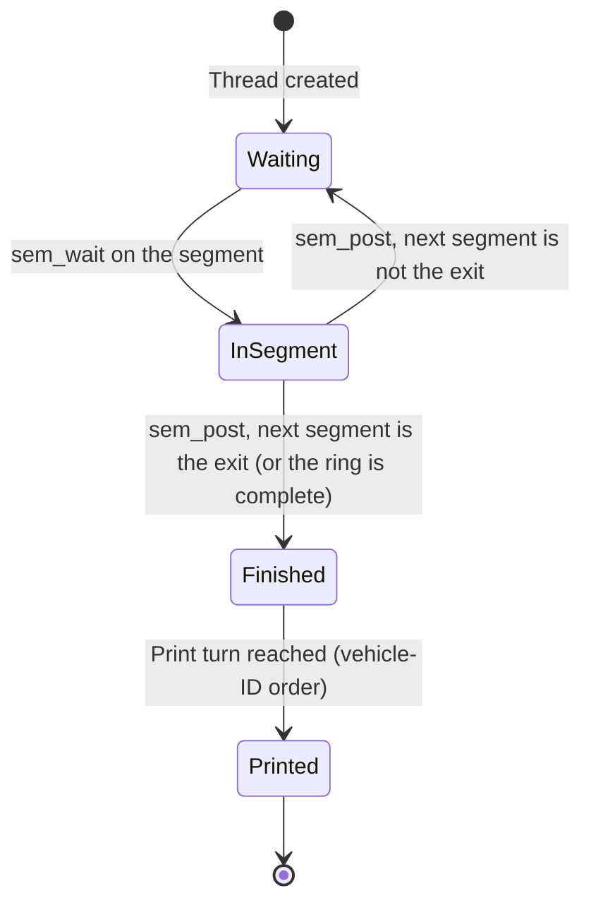

# Roundabout Traffic Simulation & Deadlock Avoidance

## 1. Overview
The Roundabout Simulator models a circular junction with four entry/exit points. Each vehicle is a POSIX thread, and the roundabout is a ring of four segments, one per point, each with a limited capacity (3 vehicles by default). Vehicles always travel the ring in the same direction:

```text
                     N (segment 0)
                   /               \
                  v                 ^
     W (segment 3)                   E (segment 1)
                  v                 ^
                   \               /
                     S (segment 2)

          Direction of travel: N -> W -> S -> E -> N
```

A vehicle entering at `N` with exit `S` passes through segments `N` and `W` and leaves at `S`. A vehicle whose exit equals its entry goes around the whole ring once.

---

## 2. Concurrency Model

### 2.1 Segment Capacity
Each segment is guarded by its own POSIX counting semaphore, initialized to the segment capacity (`src/roundabout.c`, `init_simulation`):

```c
for (int i = 0; i < NUM_SEGMENTS; i++) {
  sim_state->segments[i].segment_capacity = segment_capacity;
  sem_init(&sim_state->segments[i].capacity, 0, segment_capacity);
}
```

To cross a segment, a vehicle waits on that segment's semaphore, stays for a random transit time between `min_ms` and `max_ms`, and then posts the semaphore:

```c
sem_wait(&sim_state->segments[segment_index].capacity);   /* enter */
/* ... transit delay ... */
sem_post(&sim_state->segments[segment_index].capacity);   /* leave */
```

At most `capacity` vehicles are inside a segment at any moment.

### 2.2 Why the Simulation Cannot Deadlock
A deadlock needs the four Coffman conditions at the same time:

1. **Mutual Exclusion:** Present. A segment has a limited number of slots.
2. **Hold and Wait:** Absent. A vehicle releases its current segment (`sem_post`) before it requests the next one (`sem_wait`), so it never holds one segment while waiting for another.
3. **No Preemption:** Present. A vehicle is never removed from a segment.
4. **Circular Wait:** Impossible without hold and wait, since no vehicle waits while holding a slot.

Because condition 2 never holds, a vehicle waiting for a segment is not blocking any other vehicle, and every waiting vehicle eventually gets a slot when the vehicles inside finish their transit.

This is a simplification of real traffic: between two segments the vehicle holds no slot. A stricter model, in which a vehicle keeps its segment until it has entered the next one, would have hold and wait, and could deadlock when every segment is full of vehicles waiting for the next one. It would need an extra rule, such as limiting the vehicles inside the ring to the total capacity minus one. That variant is not implemented.

The semaphores do not guarantee FIFO order among waiting vehicles, so the simulation guarantees progress but not strict fairness.

### 2.3 Ordered Output
Vehicles finish in any order, but their results are printed in vehicle-ID order. Each thread waits on a condition variable until `next_to_print` equals its ID, prints its path under `print_mutex`, increments `next_to_print` and broadcasts (`begin_print_turn` and `end_print_turn` in `src/roundabout.c`):

```c
pthread_mutex_lock(&sim_state->order_mutex);
while (vehicle_id + 1 != sim_state->next_to_print) {
  pthread_cond_wait(&sim_state->order_cond, &sim_state->order_mutex);
}
/* ... print the trajectory ... */
sim_state->next_to_print++;
pthread_cond_broadcast(&sim_state->order_cond);
pthread_mutex_unlock(&sim_state->order_mutex);
```

A vehicle with an invalid entry or exit still takes its turn to report the error, so the vehicles after it are not left waiting.

---

## 3. Implementation

### 3.1 Data Structures
Defined in `src/roundabout.h`:

```c
typedef struct {
  int segment_capacity;
  sem_t capacity;
} Segment;

typedef struct {
  int id;
  char entry;   /* 'N', 'E', 'S', 'W' (or 'O') */
  char exit;    /* 'N', 'E', 'S', 'W' (or 'O') */
} Vehicle;

typedef struct {
  int vehicle_id;
  char path[128];
  int path_index;
  long long total_transit_ns;
} Trajectory;

typedef struct {
  Segment segments[NUM_SEGMENTS];
  Vehicle vehicles[MAX_VEHICLES];
  Trajectory trajectories[MAX_VEHICLES];
  int num_vehicles;
  int min_time;
  int max_time;
  int verbose_mode;
  int next_to_print;
  pthread_mutex_t print_mutex;
  pthread_mutex_t order_mutex;
  pthread_cond_t order_cond;
} SimulationState;
```

`NUM_SEGMENTS` is 4 and `MAX_VEHICLES` is 5,000.

### 3.2 Vehicle Transit


Each thread records the segments it crosses and its total transit time, measured with `CLOCK_MONOTONIC`. Transit delays are drawn with `rand_r` and a per-thread seed.

### 3.3 Input and Parameters
```text
roundabout [min_ms=5] [max_ms=20] [capacity=3] [-v|--verbose] [-f file]
```

- **Numbers:** `min_ms`, `max_ms` and `capacity`, in that order. Flags may appear before, between or after them. Delays must be 0 or more, `max_ms` must not be smaller than `min_ms`, and the capacity must be at least 1.
- **`-v` / `--verbose`:** Also prints each segment entry with its elapsed time.
- **`-f file`:** Reads one vehicle per line as `ENTRY EXIT` (`N`, `E`, `S`, `W`; `O` is accepted for West). Without `-f`, 15 vehicles with random, different entry and exit points are generated.

---

## 4. Verification & Testing

- **Smoke Test:** `make test` at the repository root runs `roundabout 2 5 2` (15 random vehicles, 2-5 ms per segment, capacity 2) together with the other modules.
- **Manual Checks:** Running 3,000 vehicles from a file with capacity 1 and no delay, a file with an invalid direction, and invalid parameters (capacity 0, `max_ms` below `min_ms`, `-f` without a file) all finish with the expected output or error message.
- **Resource Cleanup:** `cleanup_simulation` destroys the segment semaphores, both mutexes and the condition variable and frees the simulation state.
